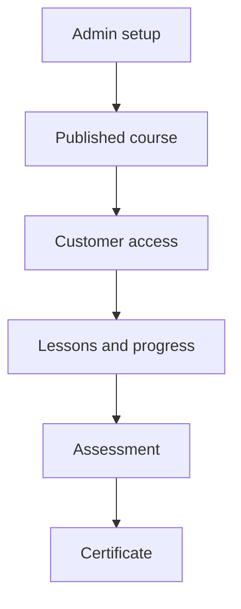
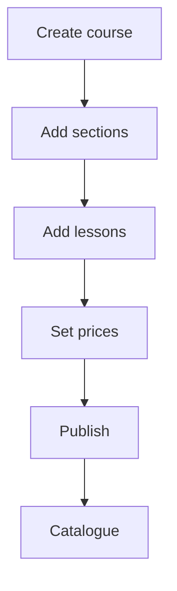
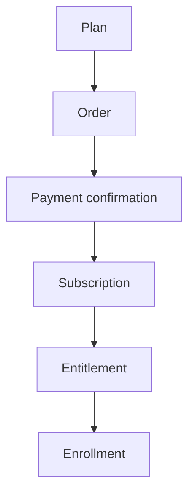
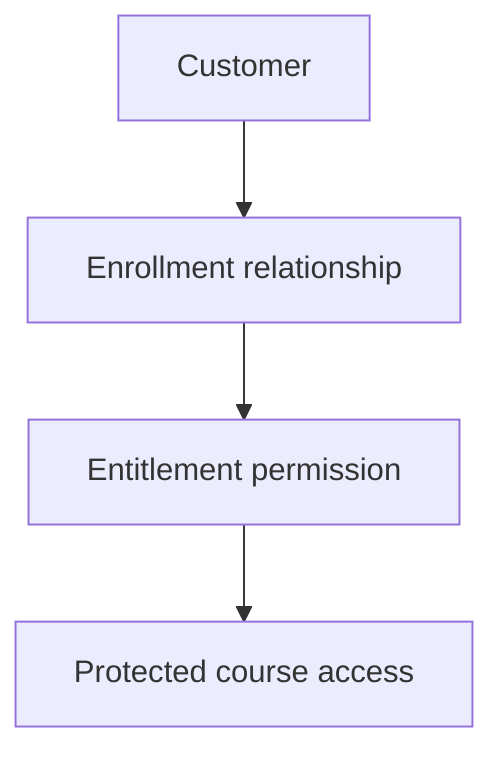
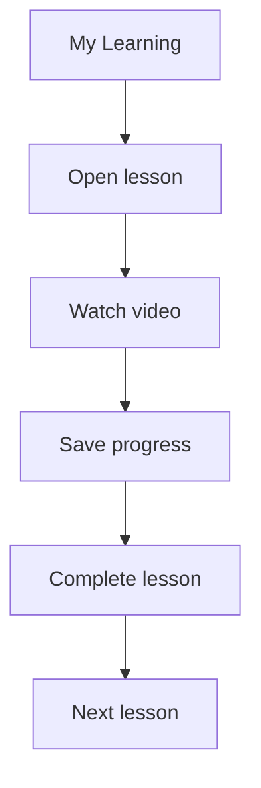
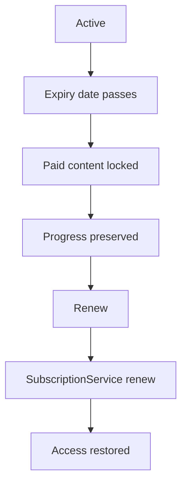
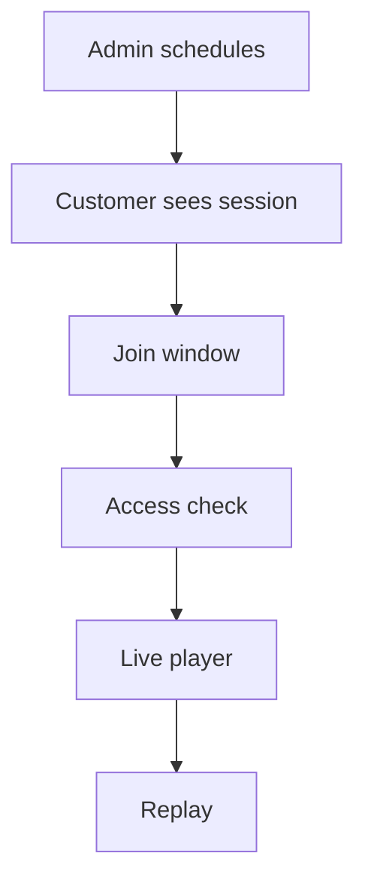
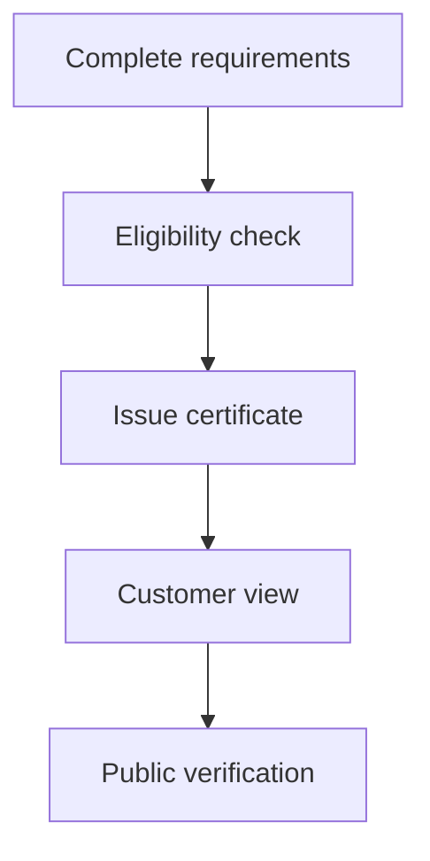
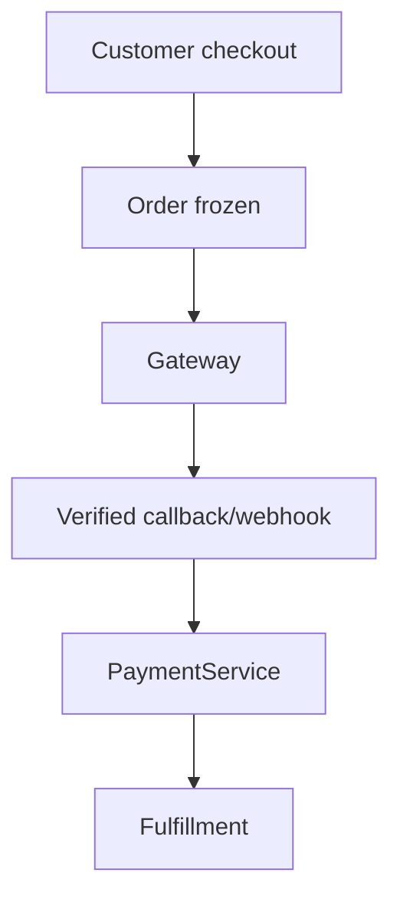
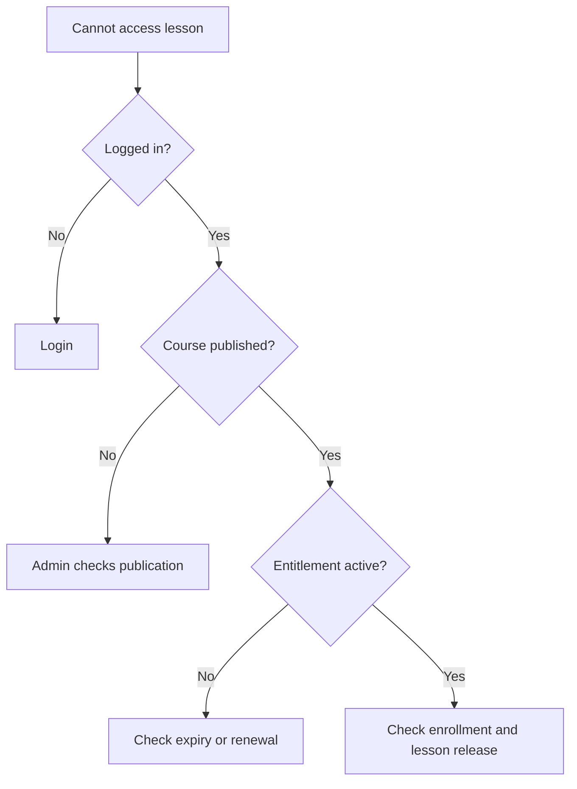

# FourSouls Flow Diagrams

## 1. LMS

## 2. Course creation

## 3. Subscription

## 4. Enrollment and entitlement

## 5. Learning

## 6. Expiry and renewal

## 7. Live session

## 8. Certificate

## 9. Payment

## 10. Troubleshooting

