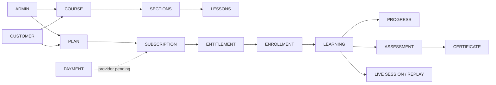

# FourSouls System Infographic

Enrollment is the course relationship. Entitlement is the current permission for protected access. A customer may retain enrollment history while an expired entitlement blocks paid lessons.
